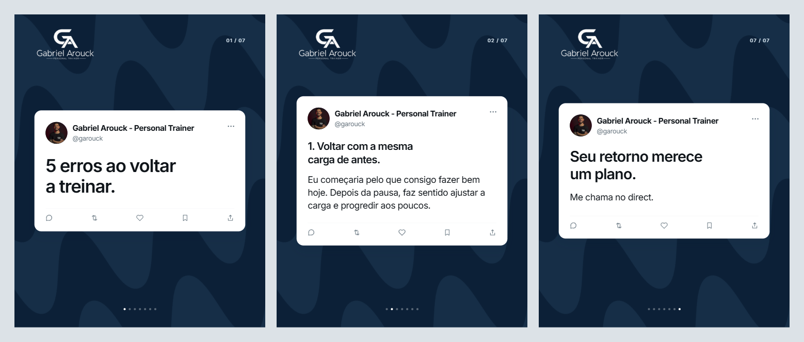

# Carrossel Twitter — Saúde

Skill para Codex que cria carrosséis de saúde, exercício e bem-estar no estilo de posts do Twitter: roteiro, HTML editável, PNGs 1080×1350 e legenda.

Inclui o modelo visual de **Gabriel Arouck - Personal Trainer (@garouck)**: azul-marinho, cartões brancos, foto de perfil e logo transparente. A identidade pode ser substituída por outra marca.



## Instalar no Codex

Peça ao Codex:

```text
Instale a skill do repositório https://github.com/caioscampos93-bit/carrossel-twitter-saude, na pasta carrossel-twitter-saude.
```

Ou baixe o repositório em **Code → Download ZIP** e copie a pasta interna `carrossel-twitter-saude` inteira para:

- Windows: `%USERPROFILE%\.agents\skills\`
- macOS/Linux: `~/.agents/skills/`

O resultado deve ser `.../skills/carrossel-twitter-saude/SKILL.md`, junto com as pastas `assets`, `scripts`, `references` e `agents`. Abra um novo chat; se a skill não aparecer, reinicie o Codex.

## Usar

```text
Use $carrossel-twitter-saude para criar um carrossel sobre [tema], em tom de opinião, com PNGs e legenda.
```

Para outra marca, informe nome, profissão, @, foto e logo. Se a nova identidade não tiver imagem, o gerador usa iniciais e omite a logo do Gabriel.

## Código e requisitos

- [SKILL.md](carrossel-twitter-saude/SKILL.md): instruções da skill.
- [Gerador](carrossel-twitter-saude/scripts/generate.cjs): conteúdo JSON → HTML autossuficiente e textos.
- [Renderizador](carrossel-twitter-saude/scripts/render.cjs): HTML → PNGs, prévias e relatório de validação.
- [Configuração](carrossel-twitter-saude/references/configuracao.md): personalização e comandos.
- [Guia de uso e repasse](COMO-USAR-E-REPASSAR.md): instruções completas.

O gerador usa Node.js. A exportação requer Playwright e Chromium, Chrome ou Edge compatível. O HTML funciona offline. Não são necessárias conta no Twitter ou chaves de API para reutilizar o layout.

O pacote foi testado com o exemplo de sete slides e outra identidade. O renderizador verifica dimensões, fontes, cortes e sobreposições. Revise o conteúdo de saúde com fontes adequadas para cada tema; a skill não substitui avaliação individual.

## Assets

Logo e captura de perfil são os materiais fornecidos para o projeto do Gabriel. Substitua-os ao usar a skill para outra identidade. A fonte Inter é distribuída sob a [SIL Open Font License](carrossel-twitter-saude/assets/INTER-LICENSE.txt).
